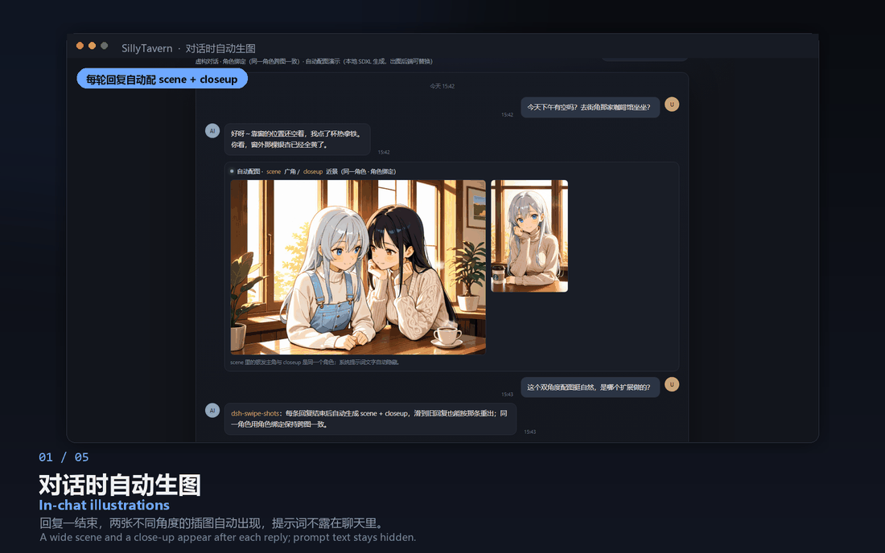
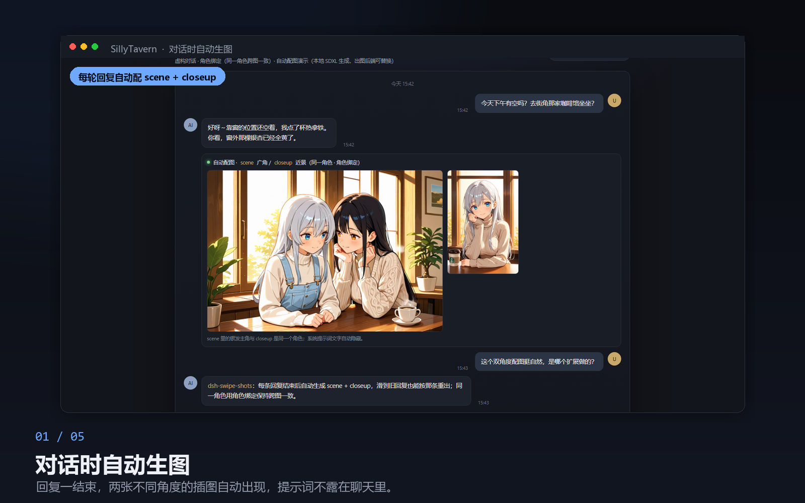

# SillyTavern DSH Pack

**A one-click Windows installer that turns a stock SillyTavern into a self-hosting roleplay studio: in-chat illustrations, auto backgrounds, character-card avatars, a vision bridge for image messages, and a GPU queue that keeps local generation from blocking the chat.**

[](https://github.com/SuperJufufu/sillytavern-dsh-pack/releases)
[](LICENSE)
[](https://github.com/SuperJufufu/sillytavern-dsh-pack/actions/workflows/ci.yml)

<p align="center">
  
</p>
<p align="center"><sub>Five things the pack adds — in-chat illustrations · character-card avatars · generated backgrounds · the right-side character drawer · a custom image-model panel.</sub></p>

## What it does

| # | Feature | What you get |
|---|---|---|
| 1 | **In-chat illustrations** | After each AI reply, a wide `scene` and a close `closeup` are generated and inserted as normal images; prompt text is hidden from the chat. |
| 2 | **Character-card avatars** | A new portrait is written back to the character card (old avatar backed up), and the same character stays consistent across shots. |
| 3 | **Generated backgrounds** | The main model decides whether the scene changed; only then is a new background generated, and the replaced file is cleaned up. |
| 4 | **Right-side character drawer** | Keep frequently used characters pinned in a drawer, switch with one click, and drag it out of the way. |
| 5 | **Custom image-model panel** | Pick the model, workflow, steps, CFG, sampler and backend (local ComfyUI or a cloud API) without editing config files. |

## Install (Windows)

1. Open **[Releases](https://github.com/SuperJufufu/sillytavern-dsh-pack/releases)** and download `SillyTavern-DSH-Pack-Setup-v0.4.3.cmd` (~625 KB).
2. Double-click it. If Windows SmartScreen appears, choose **More info → Run anyway**.
3. The installer will:
   - detect an existing **SillyTavern 1.19.1** and reuse it, or download the 1.19.1 source zip (~37 MB) when none is found;
   - check Node.js ≥ 20 and download a portable Node if needed;
   - install **14 extensions** into `<ST>/data/default-user/extensions/`;
   - apply three small **AGPL-3.0 patches** (backed up first, idempotent, `--no-patches` to skip);
   - run `npm install --omit=dev`, create a desktop shortcut, and write an install record.
4. Launch **SillyTavern DSH** from the desktop. The first start seeds `data/` with all extensions enabled.

Nothing else is touched: no system changes, no admin rights, no user data in this repository.

## What's inside

- **14 front-end extensions** — streaming, prompt/text utilities, UI simplification, generation guard, image folding, model profiles, GPU queue, swipe shots, chat naming, thumbnails, prompt stability, auto avatars, background generation and a vision bridge.
- **3 patches** against SillyTavern 1.19.1 — SD angle hints, stable prompt writer, and a Windows-safe save retry.
- **An offline installer** — checks, downloads, installs, patches, and records everything in one `.cmd`.

> The pack contains **no** SillyTavern source, **no** chats / cards / world books / images / API keys, and **no** adult content. Use it in line with your local law and GitHub's policies.

---

# 中文说明

**一键把原版 SillyTavern 变成能自己出图、自己换背景、自己更新角色卡头像的本地角色扮演工作台。** 安装器负责检测/下载 SillyTavern 1.19.1、安装 14 个扩展、打 3 个补丁、装依赖、建快捷方式；仓库里不放任何用户数据、图片或密钥。

<p align="center">
  
</p>

## 五个能力

| # | 能力 | 说明 |
|---|---|---|
| 1 | **对话时生图** | 每条 AI 回复后自动生成 `scene`（广角）与 `closeup`（近景），作为普通图片消息插入；系统提示词文字自动隐藏。 |
| 2 | **角色卡自动更新** | 自动生成的头像直接写回角色卡（旧图先备份）；同一角色跨镜头保持设定一致。 |
| 3 | **自动生成背景** | 主模型先判断场景有没有变化，变了才出图；聊天背景跟着剧情走，被替换的旧图自动清理。 |
| 4 | **右侧角色栏** | 常用角色固定在右侧抽屉，点一下切换，也可以拖出来腾地方。 |
| 5 | **自定义生图模型** | 模型、工作流、步数、CFG、采样器、后端（本地 ComfyUI 或云端 API）都在面板里改，不用碰配置文件。 |

更多截图见 `docs/showcase/carousel/`（5 张 1600×1000 PNG + 来回播放的 GIF）。

## 一键安装

1. 打开 **[Releases](https://github.com/SuperJufufu/sillytavern-dsh-pack/releases)**，下载 `SillyTavern-DSH-Pack-Setup-v0.4.3.cmd`（约 625 KB）；
2. **双击**运行（若出现「Windows 已保护你的电脑」→ 更多信息 → 仍要运行）；
3. 安装器自动：
   - **检测本机是否已有 SillyTavern 1.19.1**：有就跳过下载本体；
   - 没有就下载 ST 1.19.1 源码包（GitHub tag，约 37 MB）并解压；
   - 检测 Node.js（ST 1.19 要求 ≥ 20），没有就下载便携版（免管理员）；
   - 安装 **14 个扩展**（含 `dsh-vision-bridge`：发图→视觉模型描述→文本模型回复）到 `<ST>/data/default-user/extensions/`；
   - 应用 **ST 补丁**（`patches/`，AGPL-3.0；改前自动备份；`--no-patches` 可跳过）；
   - `npm install --omit=dev`（与 ST 自带 Start.bat 一致）；
   - 创建桌面快捷方式、写安装记录。
4. 双击桌面「SillyTavern DSH」启动；首次启动初始化 `data` 并带上全部扩展。

### 安装器行为

| 场景 | 行为 |
|---|---|
| 检测到 ST 1.19.1 | 不下载本体，直接装扩展 + 应用补丁 |
| 检测到其他版本 ST | 询问：装到已有版本 / 另装一份 1.19.1 / 退出 |
| 没检测到 ST | 下载并安装 ST 1.19.1 到 `%LOCALAPPDATA%\SillyTavern-DSH\SillyTavern` |
| 再次运行 | 同版本扩展跳过；补丁幂等；只补缺失项 |
| 无 Node.js | 自动下载便携 Node（最新 LTS） |

只写入：ST 安装目录、`<ST>/data/default-user/extensions/`、桌面快捷方式、安装记录 `%APPDATA%\SillyTavern-DSH-Pack\install.json`；不改系统、不要管理员。
日志：`%TEMP%\dsh-pack-install-*.log`。

### 安装器参数（调试/自动化）

```
--st-path <dir>      指定已有 ST 目录
--install-dir <dir>  新装 ST 目标目录
--data-root <dir>    指定 data 根（默认 <ST>/data）
--st-version <ver>   目标 ST 版本（默认 1.19.1）
--from-zip <path>    用本地 ST zip 代替下载
--mirror <prefix>    下载镜像前缀（如 https://ghproxy.net/）
--node-version <v>   指定 Node 版本
--check-only         只检测：0=已有对应版本, 2=未找到, 3=版本不符
--dry-run            只打印计划，不写文件
--skip-npm           跳过 npm install
--no-patches         跳过 ST 补丁
--no-shortcut        不创建桌面快捷方式
--no-detect          跳过自动检测（强制按 --install-dir 新装）
--no-node-download   缺 Node 时报错
--no-record          不写安装记录
--yes                自动确认
--help               显示帮助
```

## 首次启动（开屏）没有图片

整合包**不打包任何图片资源**（只分发扩展脚本 / 补丁 / 安装器，由 `scripts/check-no-images-in-payload.mjs` 校验）。
安装的 ST 1.19.1 首次启动默认背景是透明的（`backgrounds/__transparent.png`），所以开屏是深色界面 + ST logo + 欢迎弹窗，**没有背景图、没有色图**。

自查：

```bash
node scripts/check-no-images-in-payload.mjs
node scripts/check-first-run-safe.mjs --st <你的 ST 目录>
```

### 扩展清单（14）

| 扩展 | 作用 |
|---|---|
| `dsh-fast-stream` | 流式输出加速 / 更顺的逐字显示 |
| `dsh-text-semantics` | 文本语义处理与显示优化 |
| `ui-simplify` | 精简界面、隐藏多余控件、回到底部按钮 |
| `dsh-gen-guard` | 生成中断保护与重试 |
| `dsh-image-fold` | 折叠/整理聊天里的图片消息 |
| `dsh-model-config` | 模型配置面板 |
| `dsh-gpu-queue` | 本地出图排队，避免聊天被生成卡住 |
| `dsh-swipe-shots` | 每条回复自动出 scene + closeup |
| `chat-namer` | 自动给聊天起可读的名字 |
| `dsh-chat-thumbs` | 会话缩略图 |
| `dsh-prompt-stable` | 稳定提示词、角色外观一致 |
| `dsh-auto-avatar` | 自动生成并写回角色卡头像 |
| `qwen-bg` | 场景判断 + 自动背景（SDXL / Anima / Krea 2 / Qwen） |
| `dsh-vision-bridge` | 发图 → 视觉模型描述 → 文本模型回复 |

### 补丁（AGPL-3.0）

| 补丁 | 作用 |
|---|---|
| `sd-angle` | 给 Stable Diffusion 扩展加镜头角度提示 |
| `sd-stable-writer` | 稳定写入提示词，减少跨回复漂移 |
| `util-save` | Windows 下保存失败自动重试（EPERM / EBUSY） |

补丁是独立文件，不属于 MIT 部分；详见 `patches/LICENSE-AGPL-3.0`。改前会备份到 `<ST>/.dsh-pack-patch-backups/<时间戳>/`，可重复运行。

## 安全与边界

- 仓库**不包含** SillyTavern 源码、聊天记录、角色卡、世界书、图片、API key。
- 安装器只写入 ST 目录、扩展目录、桌面快捷方式和安装记录。
- 首次启动无图片；演示图只用于 README，不随安装包分发。
- 不附带成人内容；请遵守当地法律与 GitHub 政策。

## 开发

```bash
node scripts/scan-sensitive.mjs          # 发布前扫描
node scripts/check-no-images-in-payload.mjs
node scripts/check-first-run-safe.mjs --st <ST>
node tools/build-installer.mjs           # 重新打包 dist/*.cmd
```

## License

MIT（扩展与安装器）。`patches/` 为 AGPL-3.0；SillyTavern 本体为 AGPL-3.0，不在此仓库内。
