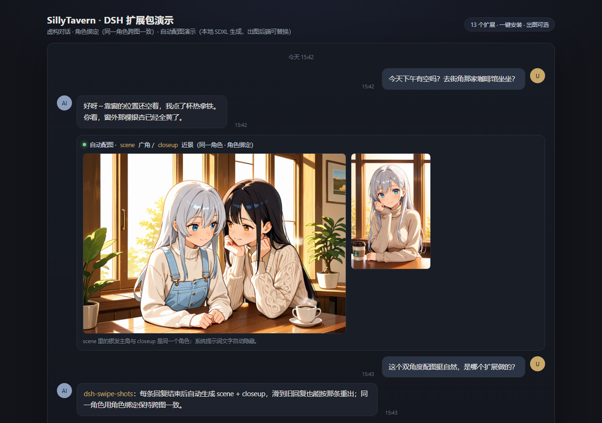

# SillyTavern DSH 扩展包（v0.3）

[](https://github.com/SuperJufufu/sillytavern-dsh-pack/releases)
[](LICENSE)
[](https://github.com/SuperJufufu/sillytavern-dsh-pack/actions/workflows/ci.yml)

> 一组给 **SillyTavern 1.19.x** 用的自研前端扩展（13 个）+ 可选 AGPL 补丁。
> **不包含** SillyTavern 本体源码、不包含任何用户数据（聊天 / 角色卡 / 世界书 / 图片 / 密钥），
> **也不包含成人向内容**。请在符合当地法律与 GitHub 政策的前提下使用/分发。

## 一键安装（推荐）

1. 到 **[Releases](https://github.com/SuperJufufu/sillytavern-dsh-pack/releases)** 下载 `SillyTavern-DSH-Pack-Setup-v0.3.0.cmd`（约 600 KB）；
2. **双击**运行（「Windows 已保护你的电脑」→ 更多信息 → 仍要运行）；
3. 安装器自动：
   - **检测本机是否已有 SillyTavern 1.19.0**：有就跳过下载本体；
   - 没有就下载 ST 1.19.0 源码包（GitHub tag，约 36.7 MB）并解压；
   - 检测 Node.js（ST 1.19 要求 ≥ 20），没有就下载便携版（免管理员）；
   - 安装 **13 个扩展**到 `<ST>/data/default-user/extensions/`；
   - 应用 **ST 补丁**（`patches/`，AGPL-3.0；改前自动备份；`--no-patches` 可跳过）；
   - `npm install --omit=dev`（与 ST 自带 Start.bat 一致）；
   - 创建桌面快捷方式、写安装记录。
4. 双击桌面「SillyTavern DSH」启动；首次启动初始化 `data` 并带上全部扩展。

### 安装器行为

| 场景 | 行为 |
|---|---|
| 检测到 ST 1.19.0 | 不下载本体，直接装扩展 + 应用补丁 |
| 检测到其他版本 ST | 询问：装到已有版本 / 另装一份 1.19.0 / 退出 |
| 没检测到 ST | 下载并安装 ST 1.19.0 到 `%LOCALAPPDATA%\SillyTavern-DSH\SillyTavern` |
| 再次运行 | 同版本扩展跳过；补丁幂等；只补缺失项 |
| 无 Node.js | 自动下载便携 Node（最新 LTS） |

只写入：ST 安装目录、`<ST>/data/default-user/extensions/`、桌面快捷方式、
安装记录 `%APPDATA%\SillyTavern-DSH-Pack\install.json`；不改系统、不要管理员。
日志：`%TEMP%\dsh-pack-install-*.log`。

### 安装器参数（调试/自动化）

```
--st-path <dir>      指定已有 ST 目录
--install-dir <dir>  新装 ST 目标目录
--data-root <dir>    指定 data 根（默认 <ST>/data）
--st-version <ver>   目标 ST 版本（默认 1.19.0）
--from-zip <path>    用本地 ST zip 代替下载
--mirror <prefix>    下载镜像前缀（如 https://ghproxy.net/）
--node-version <v>   指定 Node 版本
--check-only         只检测：0=已有对应版本, 2=未找到, 3=版本不符
--dry-run            只打印计划，不写文件
--skip-npm           跳过 npm install
--no-patches         跳过 ST 补丁
--no-shortcut        不创建桌面快捷方式
--no-detect          跳过自动检测（强制按 --install-dir 新装）
--no-node-download   缺 Node 时报错
--no-record          不写安装记录
--yes                自动确认
--help               显示帮助
```

## 效果演示（虚构对话）

> 对话与角色均为虚构，仅用于演示「自动配图」流程；图片由本地 SDXL 生成（生图后端可替换）。



| 自动生成 scene（广角） | 自动生成 closeup（近景） | 自动生成头像 |
|---|---|---|
|  |  |  |

- 本例使用 `dsh-swipe-shots`：每条 AI 回复后自动出 2 张不同角度的图，并隐藏系统图片消息里的提示词文字。
- **角色绑定**：演示图使用固定角色设定（银发主角 A + 黑发同伴 B），`scene` / `closeup` / `avatar` 保持同一角色，避免跨图人物不一致（详见 [docs/showcase/README.md](docs/showcase/README.md)）。
- 生图后端**可选**：本地 ComfyUI（SDXL / 其它模型）、云端图片 API、或其它本地服务，见 [docs/IMAGE-BACKENDS.md](docs/IMAGE-BACKENDS.md)。

## 生图后端（可选 / 可替换）

- **默认**：ST 内置 Stable Diffusion 扩展 + ComfyUI（SDXL）；`patches/` 全部可选，安装器 `--no-patches` 可跳过。
- **换本地模型**：在 ComfyUI 里换 checkpoint / workflow 即可（SD1.5 / SDXL / Illustrious / Flux / Qwen-Image…），本包无需改代码。
- **换云端 API / 其它服务**：自定义脚本覆盖 `window.__DSH_SD_ANGLE_GENERATE`，骨架见
  [examples/cloud-image-adapter.example.js](examples/cloud-image-adapter.example.js)。
- **不要出图**：不装出图后端时，相关扩展自动降级，聊天与其它功能不受影响。
- 详细说明：[docs/IMAGE-BACKENDS.md](docs/IMAGE-BACKENDS.md)。

## 手动安装

1. 准备 **SillyTavern 1.19.x**。
2. 把 `extensions/` 下每个文件夹复制到 `<SillyTavern>/data/default-user/extensions/`。
3. （可选，推荐）应用补丁：`node patches/apply.mjs --st <SillyTavern 目录>`；改前自动备份，可重复运行。
4. 刷新页面（**Ctrl+Shift+R**），在 Extensions 面板按需开启。

卸载：删除扩展文件夹（或整个 ST 目录）+ 桌面快捷方式；补丁备份在 `<ST>/.dsh-pack-patch-backups/`。

## 包含的扩展（13 个）

| 扩展目录 | 名称 | 版本 | 作用 | 额外依赖 |
|---|---|---|---|---|
| `dsh-fast-stream` | DSH 流式加速 | 1.0.0 | 关掉 ST 平滑流式（按 token 加延迟），刷新率拉满 | 无 |
| `dsh-text-semantics` | DSH 文本语义配色 | 1.1.0 | 按语义给聊天正文分色（斜体=环境、对白=橙、加粗=内心、下划线=动作、等宽=系统） | 无 |
| `ui-simplify` | 界面精简 | 2.4.0 | 加宽内容区、图标式按钮、右侧面板折叠、防自动跳底 | 无 |
| `dsh-gen-guard` | DSH 生成看门狗 | 1.1.1 | 「生成中」卡死自动解锁，并给图片折叠提供排队信号 | 无 |
| `dsh-image-fold` | DSH 图片折叠 | 1.1.4 | 生成图折叠成小缩略条（重绘/删除/点开大图） | SD 出图链路 |
| `dsh-model-config` | DSH 本地模型配置 | 1.0.1 | 把记忆表格/角色卡更新用的 LLM 指向本地 Ollama，并关 thinking | 本地 Ollama（11434） |
| `dsh-gpu-queue` | DSH 重任务排队 | 1.0.0 | 生图 / 背景图 / 本地 LLM 重任务串行 | 无 |
| `dsh-swipe-shots` | DSH 角度配图 | 1.1.0 | 每条回复后出 2 张不同角度图 + 隐藏提示词文字 | 补丁 + ComfyUI |
| `chat-namer` | 对话自动命名（DeepSeek） | 2.1.0 | 用 ST 模型给对话起中文标题，每 5 轮更新 | ST 模型 API |
| `dsh-chat-thumbs` | 聊天列表（封面 + 预览） | 1.3.1 | 欢迎页聊天列表用场景插画当封面 + 预览清洗/标题整理 | 无（map.json 运行时生成） |
| `dsh-prompt-stable` | DSH 写词稳定器 | 1.2.0 | 条件宏模板 + 全局外观核心标签 + 缓存 + 规则兜底 + 思考折叠 | 补丁（SD 写词钩子） |
| `dsh-auto-avatar` | 自动画头像（SDXL） | 1.0.1 | 第一轮自动给首个角色画头像（可选 persona 头像） | 补丁 + ComfyUI |
| `qwen-bg` | 背景图（先判断场景，变了才换） | 3.4.2 | 场景判断 → 出背景 → 换图/清理旧图；主页固定背景 | 补丁 + ComfyUI + 可选本地判断模型 |

## 依赖与配置

- **出图类**（`dsh-swipe-shots` / `dsh-image-fold` / `dsh-auto-avatar` / `qwen-bg`）：
  需要 ST Stable Diffusion 扩展 + ComfyUI（默认 `8188`；桥接默认 `8189`，可在面板/常量改）。
- **`chat-namer`**：用 ST 当前模型（默认 DeepSeek），请自行配置 API key。
- **`dsh-model-config`**：默认 `http://127.0.0.1:11434` + `gemma4-e4b-ctx8k:latest`（Ollama），可改常量。
- **`dsh-prompt-stable` v1.2.0**：面板里可配置「外观世界书名单」（逗号分隔，留空=只用角色卡/人格绑定的书）与「角色别名 JSON」。
- **`dsh-chat-thumbs` v1.3.1**：不打包运行时生成的 `map.json`，首次使用会现场读取聊天里的【场景插画】消息。
- **`qwen-bg` / `dsh-auto-avatar` v0.3 泛化**：ComfyUI 桥接/判断模型地址在文件顶部常量；世界书名单在面板配置；不依赖任何私有角色/书名。

## 补丁（`patches/`，AGPL-3.0）

`patches/` 下的脚本会修改 SillyTavern 1.19.x 源码（Stable Diffusion 扩展、`src/util.js` 等），
这些脚本与生成物以 **AGPL-3.0** 发布（全文 `patches/LICENSE-AGPL-3.0`）；扩展本身仍是 MIT。

```bash
# 查看补丁状态 / 应用 / 撤销（撤销=用备份覆盖）
node patches/apply.mjs --st "<SillyTavern>" --list
node patches/apply.mjs --st "<SillyTavern>" --check
node patches/apply.mjs --st "<SillyTavern>"
```

默认应用 `sd-angle`（角度配图接口）、`sd-stable-writer`（写词稳定器钩子）、`util-save`（聊天保存修复）等；
安装器会自动调用。**未打补丁时**：扩展照常加载，但 `dsh-swipe-shots` 角度图与写词钩子不生效。

## 不包含的内容

- 成人向扩展（`adult-defaults`）与角色专属扩展（`narrator-lore`、`sd-appearance`）不在仓库内。
- 第三方扩展不打包，请从上游安装：

| 扩展 | 上游 | 许可证 |
|---|---|---|
| 酒馆助手（JS-Slash-Runner） | https://github.com/N0VI028/JS-Slash-Runner | PolyForm Noncommercial 1.0.0 |
| 角色卡自动更新（AutoCardUpdaterExtension） | https://github.com/1830488003/AutoCardUpdaterExtension | MIT |
| 记忆增强表格（st-memory-enhancement） | https://gitee.com/muyoou/st-memory-enhancement | 未声明（不打包） |

## 许可证 / 安全

- 扩展与安装器：**MIT**（`LICENSE`）；补丁脚本：**AGPL-3.0**（`patches/LICENSE-AGPL-3.0`）。
- SillyTavern 本体：AGPL-3.0，本仓库不含其源码。
- 第三方归属见 `NOTICE`。
- 发布前自查：`node scripts/scan-sensitive.mjs`（要求 PASS）。
- 发布使用**全新 Git 历史**，不要从旧目录 push。

## 构建 / CI

```bash
node tools/build-installer.mjs          # 产物 dist/SillyTavern-DSH-Pack-Setup-v0.3.0.cmd
```

- `.github/workflows/ci.yml`：push/PR 时自动扫描 + 语法检查 + 构建安装包（产物仅 artifact）。
- `.github/workflows/release.yml`：推送 `v*` tag（或手动 dispatch）时构建并创建 Release，自动附加安装包。
- `dist/` 已被 `.gitignore` 忽略；安装包只放 Releases，不提交进仓库。

## 目录结构

```
sillytavern-dsh-pack/
├── README.md / CHANGELOG.md / LICENSE / NOTICE / .gitignore
├── extensions/              # 13 个扩展（MIT）
├── patches/                 # ST 补丁脚本（AGPL-3.0）+ apply.mjs
├── installer/               # 安装器源码（bootstrap.cmd + install.ps1）
├── tools/build-installer.mjs
├── docs/EXTENSIONS.md / IMAGE-BACKENDS.md / showcase/
├── examples/                # 可选后端替换示例（不随安装包分发）
├── scripts/scan-sensitive.mjs
├── .github/workflows/       # CI + Release
└── dist/                    # 构建产物（不提交）
```

## 已知限制

- 只在 Windows 11 + Chrome 的 ST 1.19.0 上实测；安装器需要联网（ST / Node / npm）。
- 部分扩展面向「本地 ComfyUI + Ollama」环境，纯云端环境可能用不上。
- 不保证与未来 ST 版本兼容；升级 ST 前请备份 `data/`。

## English

A pack of self-built client-side extensions (13) for **SillyTavern 1.19.x**, plus a one-click Windows
installer and optional AGPL-3.0 patches. It contains **no SillyTavern source, no user data, no adult
content**. Extensions are MIT; patches are AGPL-3.0; see NOTICE for attribution.
