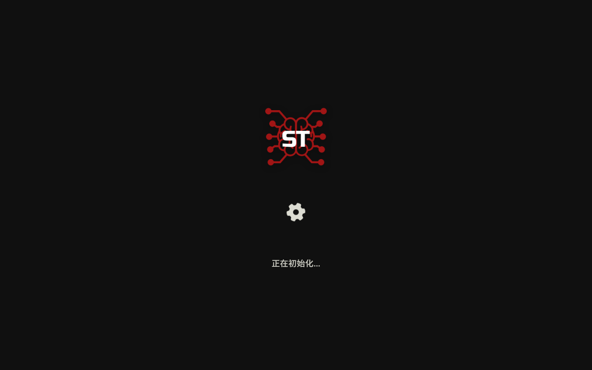
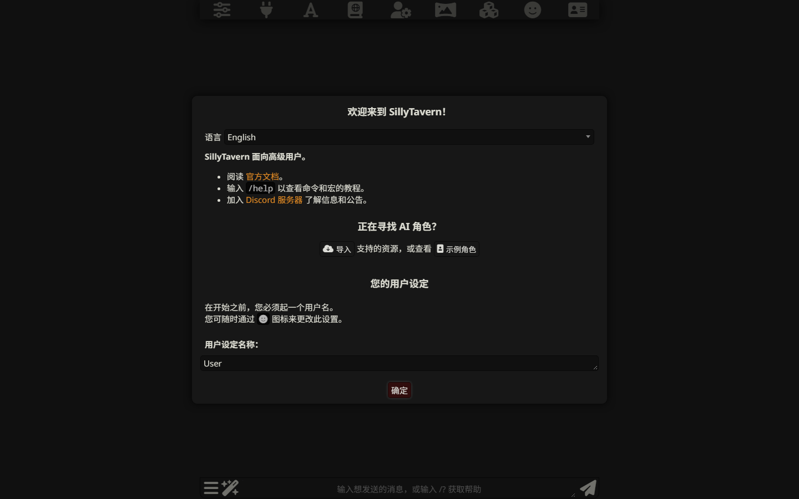

# 首次启动（开屏）安全说明

> 结论：**整合包安装出来的 SillyTavern，首次打开是深色界面 + ST logo + 欢迎弹窗，没有背景图、没有色图。**
> 本包不含任何图片资源；ST 1.19.0 的默认背景是透明的。

## 为什么可以确定

| # | 检查点 | 结论 |
|---|---|---|
| 1 | 安装包 payload（`installer/` + `extensions/` + `patches/` + LICENSE/NOTICE） | 不含任何图片文件；`scripts/check-no-images-in-payload.mjs` PASS（CI 强制） |
| 2 | ST 1.19.0 `default/content/settings.json` | `background=null`、`custom_background=null`、`active_character=null` |
| 3 | ST 1.19.0 欢迎模板 `public/scripts/templates/welcomePanel.html` | 只引用 `img/logo.png`；最近对话缩略图在全新安装时为空列表 |
| 4 | ST 1.19.0 默认背景资源 | `backgrounds/__transparent.png`（1×1 透明像素），即首次启动不显示图片 |
| 5 | ST 1.19.0 默认主题 / `user.css` | 没有 `background-image` / 图片 `url(...)` |
| 6 | 实测 | 全新 dataRoot 启动 ST 1.19.0 + Chrome 无头截图（下方两张） |

## 实测截图

| 启动 splash | 首次欢迎弹窗 |
|---|---|
|  |  |

截图环境：`st-tools/st-119/SillyTavern-1.19.0` 源码 + 全新空 `dataRoot`（首次启动自动 seed 默认内容），
Chrome 156 headless，1440×900；打开 `http://127.0.0.1:8123/` 后截取。

## 哪些图不会被安装

- `docs/showcase/` 里的演示图（`demo-chat.png`、`scene.jpg`、`closeup.jpg`、`avatar.jpg`）只用于
  README 展示，**不会**随安装包分发、**不会**写进 ST 的 `data/`。
- 安装器只写：ST 安装目录、`<ST>/data/default-user/extensions/`、桌面快捷方式、安装记录。

## 不属于本包、但可能出现的图

- **默认角色卡**：ST 官方自带的角色卡与表情图（SFW，官方默认内容），在角色列表/聊天里出现，
  **不在开屏上**；不需要的话在 ST 角色管理里删除即可。
- **已有 ST 的用户数据**：如果安装器检测到本机已有 ST 并安装进去，它不会改动你的 `data/`
  （背景、角色、聊天都是你自己的）。
- **你自己配置的生图/背景扩展**（如 `qwen-bg`）只在你主动开启并配置后才出图，首次启动不会触发。

## 复查方式

```bash
# 1) 安装包不含图片（CI 已强制）
node scripts/check-no-images-in-payload.mjs

# 2) ST 首次启动画面安全（对着 ST 安装目录跑）
node scripts/check-first-run-safe.mjs --st "<SillyTavern 目录>"
```

两个脚本都输出 `PASS` 才算通过；`check-first-run-safe.mjs --verbose` 会列出欢迎模板的图片引用与默认背景值。

## 版本前提

- 安装器固定下载 **ST 1.19.0（GitHub tag）**，上述默认内容与该版本一致；
- 若未来 ST 默认内容变化，`check-first-run-safe.mjs` 会失败提醒，需要重新人工复核并更新本说明。
